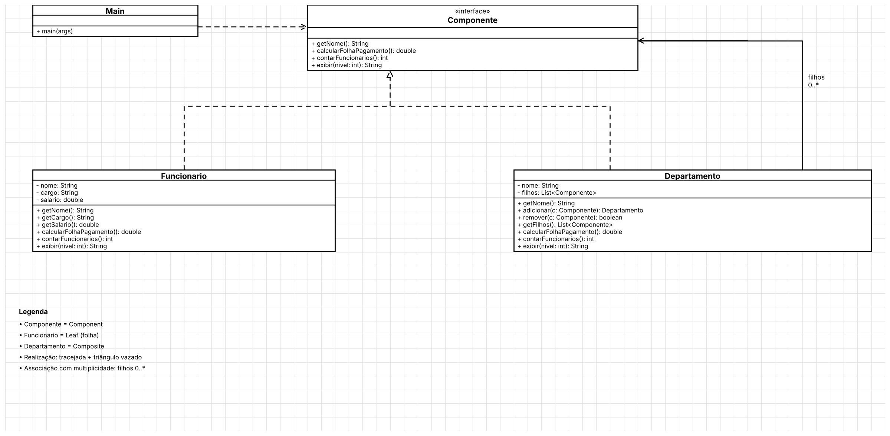

# Padrão Composite — Organograma e folha de pagamento hospitalar

Exemplo do padrão estrutural **Composite**: um hospital é organizado em departamentos que contêm funcionários e outros departamentos. Folha de pagamento, contagem de funcionários e exibição da estrutura são calculadas da mesma forma para um funcionário isolado ou para o hospital inteiro.

## Diagrama UML

## Participantes do padrão

| Papel | Classe |
|---|---|
| Component | `Componente` |
| Leaf | `Funcionario` |
| Composite | `Departamento` |
| Cliente | `Main` / `Hospital` (monta a árvore de exemplo) |

## Casos de teste (JUnit 5)

`ComponenteTest` (11 testes): folha retorna o próprio salário; salário negativo é rejeitado; departamento vazio; folha total do hospital (R$ 39.500,00 / 5 funcionários); subdepartamentos aninhados; uso uniforme pela interface; exibição hierárquica; atualização dos totais ao adicionar e remover; proteção contra nulo/auto-inclusão; lista de filhos somente leitura.

## Como executar

- **IntelliJ**: `File > Open` e selecione a pasta do projeto (o `pom.xml` é importado automaticamente; JDK 11).
  - Testes: botão direito em `src/test/java` > *Run 'All Tests'*.
  - Demonstração: execute a classe `padroesestruturais.composite.Main`.
- **Maven**: `mvn test`

O diagrama pode ser regerado com `python docs/gerar_uml.py` (requer matplotlib).
